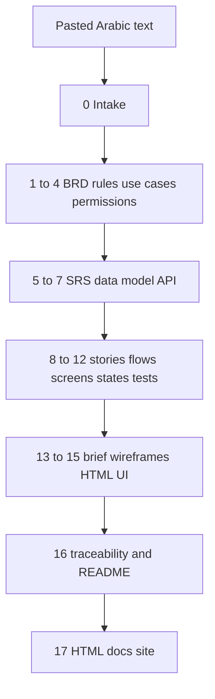
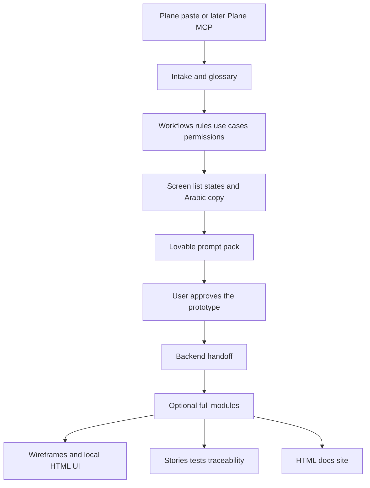

# Product Design Pipeline — migration audit

No files in the skill were modified for this audit. This document is the audit and the proposed repair. Implementation waits for approval.

Audited on 11 October 2026. Skill name: `product-design-pipeline`.

Two copies exist and they are not equivalent:

- Workspace (this repo): `d:\Skills\product-design-pipeline`. Includes nested `feature-forge/` and `frontend-design/`.
- Claude install that Cursor currently indexes: `C:\Users\Nuha\.claude\skills\product-design-pipeline`. Same `SKILL.md`, `references/`, and `assets/` (byte-identical). Missing both nested skill folders.
- Not installed as a Cursor skill. Absent from the user Agent Store and from `.cursor/skills/`.

Sibling Claude skills `feature-forge` and `frontend-design` exist under `C:\Users\Nuha\.claude\skills\`. Cursor can see them on this machine because it indexes that folder. A skill that only lives in this repo will not.

## Actual workflow this skill must serve

1. Client requirements are written in simple Arabic inside Plane.
2. Business workflows and expected system behavior are documented.
3. Lovable generates UI screens and interactive prototypes.
4. Approved workflows, screens, business rules, and backend requirements are handed to a backend developer.

## 1. Current architecture and file inventory

The skill is one linear 18-step run (stages 0–17) with a gate after every stage. Output is a new folder `./product-design/NN-slug/` of English markdown plus Arabic RTL HTML. There is no `scripts/` directory. Verification is prose plus five `grep` lines.

That order writes the backend contract before any screen is approved. The real order is Plane notes, then workflows and behavior, then Lovable screens, then a backend handoff of what was approved.

### Skill root

- `SKILL.md` — 22 KB, 402 lines. Frontmatter `name` and `description` are valid for Cursor (`description` is 685 characters; limit is 1024). Extra metadata keys are ignored by Cursor, not harmful. No `scripts/`, no evals, no slash-command file for `/product-brief`.

### References loaded by stage

All present:

- `references/intake-questions.md` — stage 0 and 13a
- `references/requirements-templates.md` — stages 1–4
- `references/spec-templates.md` — stages 5–7
- `references/backlog-templates.md` — stages 8, 12, 16
- `references/ux-templates.md` — stages 9–11
- `references/design-brief-template.md` — stage 13
- `references/style-picker-guide.md` — stage 13b
- `references/wireframe-guide.md` — stage 14
- `references/rtl-html-guide.md` and `references/flow-board-guide.md` — stage 15
- `references/html-docs-guide.md` — stage 17, 35 KB

### Assets

- `assets/style-library.html` — 221 KB. Master style picker. `localStorage` on `file://`, Chrome or Edge only.
- `assets/style-library-rules.md` — 48 KB. Book rules tagged `[stated]` or `[inferred]`.
- `assets/archetypes.md` — referenced from the rules file, not from `SKILL.md`.

### Nested skills, present only in this repo

- `feature-forge/SKILL.md` plus five reference files. The pipeline is supposed to load only `ears-syntax.md` and `acceptance-criteria.md`.
- `frontend-design/SKILL.md`. Invoked as a skill name, not as a file read.

### External tools the skill assumes

- Claude tool `AskUserQuestion` (stage gates and intake).
- Claude slash command `/product-brief` (description only; no command file).
- Sibling skill invocation for `frontend-design`.
- A local browser opening `file://` HTML (style picker, flow board, docs site).
- `bash` `grep` for stage 17c. The machine under audit is PowerShell.
- GitHub repo `anthropics/html-effectiveness` as a pattern source. The tokens and folder contract are already inlined, so a fetch is not required.

### Tools checked in this session

- Plane: no MCP namespace, no skill, no token, no config. The skill cannot read Plane issues.
- Lovable: namespace `plugin-lovable-lovable` exists and is `needsAuth`. Only `mcp_auth` is exposed until the plugin is authenticated. The skill never mentions Lovable.

## 2. Missing dependencies and broken references

Broken paths, if resolved from the reference file’s own directory:

- `references/spec-templates.md` line 8 loads `../../feature-forge/references/ears-syntax.md`. From `references/` that escapes the repo to `d:\Skills\feature-forge\...`, which is not there. The correct in-repo path is `../feature-forge/references/ears-syntax.md`.
- `references/backlog-templates.md` line 8 has the same `../../feature-forge/references/acceptance-criteria.md` error.
- Both files also mention `feature-forge/references/...` without a `../`. That path is correct only when resolved from the skill root. The installed Claude copy does not contain `feature-forge/` at all, so that load fails there too.

Missing files:

- `frontend-design/LICENSE.txt`, cited in that skill’s frontmatter. Also missing from the sibling Claude skill (only `SKILL.md` is there).
- `feature-forge` related skills named in its frontmatter: `fullstack-guardian`, `spec-miner`, `test-master`. Not bundled. Harmless if the pipeline never runs the Feature Forge workshop.
- No Plane client, issue template, or field map.
- No Lovable prompt template.
- No Cursor tool map (`AskQuestion`, shell, browser).

Not missing, despite looking unused: every stage reference and all three assets exist and are cited.

## 3. Claude-specific instructions requiring migration

| Instruction | Where | Cursor-compatible replacement |
|---|---|---|
| Call `AskUserQuestion` | `SKILL.md`, intake guide | Cursor `AskQuestion`. One question per call is safest; keep the “at most four” batch as up to four `AskQuestion` calls. Options need ids. Free-text answers stay in chat. |
| `AskUserQuestions` (plural) | `feature-forge` skill and interview guide | That name is not a real tool in Claude or Cursor. Do not invoke the Feature Forge workshop. Keep only the EARS and Given/When/Then references. |
| `/product-brief` | description | Cursor triggers from the description, or when the user names the skill. Drop the slash command, or add a project command later. Mention Plane, Lovable, and backend handoff in the description so it still triggers. |
| “Use the `frontend-design` skill” | `SKILL.md`, RTL guide, style-picker guide | Tell the agent to read `frontend-design/SKILL.md` inside this repo. Nested `SKILL.md` files are not registered skills. |
| Task subagents plus Architecture Designer / Security Reviewer / Framework Expert | `feature-forge` pre-discovery | Cursor has a Task tool, but those subagents expect an existing codebase. This pipeline starts from Arabic notes. Leave that file unused. |
| `file://` + Chrome/Edge `localStorage` | style picker, flow board, docs guide | Keep local HTML as an optional review surface. Add an in-chat `AskQuestion` path for style choices so a run is not blocked on Chrome. Cursor’s browser is not a `file://` origin, so `localStorage` will not survive there. |
| Stage 17c `grep` bash block | html-docs guide | Use `rg` in the Cursor shell. Do not assume `bash` or GNU `grep` on Windows. |
| “Claude is capable of extraordinary creative work” | frontend-design | Wording only. Replace when that file is edited. |
| Skill install location | Claude `~/.claude/skills` | To run from this repo, copy or link it into the user Agent Store at `skills/product-design-pipeline/`, or into `.cursor/skills/` of the project where it is run. |

What already works in Cursor without a rewrite: reading these markdown files, writing the run folder, English/Arabic language split, id registry, gate-then-approve, and the templates themselves.

## 4. Workflow design problems

The package is built for a team that wants a full spec, ASCII wireframes, a hand-built Arabic UI gallery, and an HTML docs site. The real workflow needs a smaller, later handoff.

Problems, in the order they waste work:

- **No Plane intake.** Stage 0 expects pasted Arabic. Plane issue title, description, comments, and acceptance notes have no field map, so a paste can drop comments that hold the real rules.
- **Backend contract is written before the UI is approved.** Stages 6–7 (data model, API) and 8–12 (stories, tests) run before stages 13–15. If Lovable changes a screen, those documents are already stale. The handoff is “approved workflows, screens, rules, and backend needs.”
- **UI is generated three times, and none of them is a Lovable prompt.** Stage 14 draws every screen in ASCII. Stage 15 builds one HTML file per screen, a gallery, and a flow board. The same screens are then rebuilt in Lovable. The flow board’s client-review value is real; it is also the most expensive artifact in the run.
- **Stage 13b blocks the run on a manual Chrome session** of a 221 KB picker. The guide says wait and do not guess. That is correct for quality and costly for every project.
- **Seventeen default gates.** Batch approval exists, but only if the user says so. A normal run is seventeen round-trips before a backend developer sees a document.
- **Stage 17 re-reads all fifteen documents and emits sixteen HTML pages** plus SVG diagrams, filters, and a verification table. Useful as a browser front door. Disproportionate when the reader is one backend developer.
- **Secondary style tier contradicts the no-silent-default rule.** `references/style-picker-guide.md` says secondary components are “collapsed, defaults implied.” `SKILL.md` says never default an unchosen component silently.
- **`frontend-design` fights the rest of the pipeline.** It asks for bold Latin-first aesthetics, hover, and unexpected layout. The platform table forbids hover-only on mobile, and the RTL guide says Arabic fonts and the user’s style picks win. The precedence section in the style-picker guide tries to reconcile this, but the frontend-design file itself does not know about it.
- **Feature Forge, if followed as a skill, starts a second workshop** and writes `specs/{feature}.spec.md`. That collides with the numbered run folder. The pipeline only needs its syntax references.

What is worth keeping, because deleting it loses a real capability:

- Run folder + `00-run-log.md` + permanent ids + assumption/question registry. This is what stops a later stage from inventing quietly.
- English documents, Arabic UI copy, glossary of source terms.
- Business rules with provenance, enforcement point, and violation response.
- Use cases and user flows. These are the expected system behavior already written by hand.
- Permission matrix. Backend needs it.
- EARS functional requirements and a data model / API sketch, after the screens and rules are approved, and labeled as a sketch (the API template already says “sketch, not a specification”).
- Traceability, at least the gap list. The full matrix is the check that a rule has a test and a screen.
- Platform question asked at intake and confirmed before visual work.
- One screen per file, RTL logical CSS, and the flow board, when Lovable is not used.
- Style library and citations, when component-level control is wanted. Lovable will not honor a 40-component picker unless the prompt is much shorter.

## 5. Risks of generating unsupported or invented requirements

The skill’s prose says “do not invent; flag `A-xx`.” Several templates push the other way. A model will copy the examples.

- **Implied screen catalogue** in `references/ux-templates.md`: “include them unless explicitly ruled out,” then lists splash, OTP, cart, checkout, orders, biometric unlock, force-update, print views, audit log, and so on. A clinic or internal tool inherits an e-commerce app. The sample rows even use phone OTP as `S-01`–`S-04`.
- **NFR table** in `references/spec-templates.md` ships concrete targets: p95 2.5 s, 2,000 concurrent users, 99.5% uptime, bcrypt cost 12, JWT lifetimes, 7-year retention, offline queued writes. The rule “every NFR needs a number” then forces a number the client never gave. Those belong in `A-xx` or they should be omitted until a number is supplied.
- **API conventions stated as facts:** `/api/v1`, Bearer JWT, cursor pagination, `Idempotency-Key`, integer money. Fine as a labeled default proposal. Dangerous as a contract the backend developer is told to build.
- **Data model quality bar:** “enough that a schema can be written without guessing.” Combined with “do not invent entities,” the model fills the gap with entities.
- **Personas and objectives** require age, volume, baseline, and target. The template’s own example is “6 min → 90 s” for booking. If the Arabic note has no measure, that example leaks in.
- **Story points and a 13-point split rule** invent an estimate and then reshape scope to fit it.
- **Style library `[inferred]` rules** are easy to present as book facts. The guide warns against this; stage 15 still has to “build what they picked.”
- **`frontend-design`** tells the model to make unexpected creative choices. That adds UI the requirements do not contain.
- **Stage 17** forbids content that is not in the source, then asks for computed diagrams and stat cards. Derived views are fine. New business rules in the HTML are not. The guide is clear; the failure mode is a long generation pass that fills gaps.

The assumption registry is the right control. The repair should make templates fail closed: if the source did not say it, the row is `A-xx` or it is absent. No sample product (booking, cart, OTP) in a template the model is told to repeat.

## 6. Proposed modular architecture

Keep one run folder and one id registry. Split the pipeline into modules with two profiles. Default profile matches the real work. The current 17-stage package stays available as `full`.

### Profile `handoff` (default)

1. Intake from pasted Plane text (issue title, description, comments). Record what was not available. Do not claim the issue was read from Plane.
2. Business behavior: BRD scope, business rules, use cases, permission matrix, user flows. Same templates, shorter gates (one gate for this block unless per-document gates are requested).
3. Screen and state list with Arabic copy tables. Only screens the source or an approved assumption supports. Platform question stays mandatory.
4. Lovable prompt pack: one prompt per flow, Arabic RTL, behavior, empty/error states, and a “do not add screens” list. Written to the run folder so it can be pasted even when Lovable MCP is unauthenticated. If Lovable is authenticated later, the same pack can be sent with the Lovable tools; that send stays a separate, explicit step.
5. After the prototype is approved: data model, API sketch, SRS for the approved behavior, open questions, and a backend README. Traceability gap list for this smaller set.

### Profile `full` (retained, not the default)

Everything in `handoff`, plus the current stages 8, 12, 13b–15, 16 matrix, and 17. Style picker, wireframes, HTML gallery, flow board, and docs site stay documented. Opt in with “full package” or “local UI, not Lovable.”

### Shared rules that do not move

- English markdown, Arabic UI strings, glossary, `A-xx` / `Q-xx`, permanent ids, new run folder per run, resume from `00-run-log.md`.
- Platform confirmed before any visual or Lovable prompt.
- No silent defaults for style, NFRs, or screens.

## 7. Prioritized repair plan

Do this only after approval. No deletions of working reference files in the first pass.

### P0 — make the current skill runnable in Cursor

- Point gates at `AskQuestion`. Document free-text fallback.
- Fix the two `../../feature-forge` paths to `../feature-forge/references/...`.
- Change “use the frontend-design skill” to “read `frontend-design/SKILL.md` in this repo.”
- State that Feature Forge’s workshop, interview, and Task-subagent files are not part of this pipeline.
- Note Windows: stage 17c uses `rg`, not `bash` grep.
- Extend the description with Plane notes, Lovable prompts, and backend handoff, and drop the dependence on `/product-brief`.
- Add a short Cursor runtime note: where the skill must be installed, and that Plane MCP is absent.

### P1 — stop invented requirements

- Rewrite the “screens flows always imply” list into a per-product checklist. A screen is included only if the source names it or an `A-xx` is accepted.
- Mark the NFR number table and the API convention block as examples of shape, not defaults to copy. Missing numbers stay open questions.
- Add a “source support” column or tag on rules, entities, and endpoints: `source` vs `assumption`.

### P1 — fit the real workflow without removing the old one

- Add a profile switch at stage 0: `handoff` (default) or `full`.
- Add a Plane paste schema to intake (title, description, comments, acceptance). Explicit “not connected to Plane” until an MCP exists.
- Add a Lovable prompt template and a stage that writes prompts from approved flows, screens, rules, and Arabic copy. Do not call Lovable until the plugin is authenticated and a send is requested.
- Move data model, API sketch, and backend README to after prototype approval in the `handoff` profile.
- Resolve the style-picker contradiction: secondary components are unchosen, not silently defaulted.

### P2 — cost controls inside `full`

- Keep stages 14, 15, and 17 behind the `full` profile.
- Offer style choices in chat in batches, and keep the HTML picker as the optional detailed path.
- Allow one combined gate per module (behavior, screens, backend) unless per-document gates are requested.

### P3 — install

- After the text is stable, install the repo copy as the Cursor skill so it no longer depends on the thinner Claude folder.

## 8. Files to create, modify, retain, or remove

### Create

- `references/profiles.md` — `handoff` vs `full`, stage order, what each profile skips and what is lost by skipping it.
- `references/plane-intake.md` — paste schema and the “no Plane MCP” rule.
- `references/lovable-prompts.md` — prompt shape for Arabic RTL prototypes, one flow per prompt, forbidden inventions.
- `references/cursor-runtime.md` — `AskQuestion`, path rules, `rg`, install location, Lovable auth gate.

### Modify

- `SKILL.md` — profiles, tool names, stage order for `handoff`, description, pointers to the new references. Keep the id registry, language rules, and gate protocol.
- `references/intake-questions.md` — Plane fields, profile question, `AskQuestion`.
- `references/ux-templates.md` — remove the mandatory commerce/auth screen list as a default.
- `references/spec-templates.md` — fix the feature-forge path; label NFR and API examples as non-binding.
- `references/backlog-templates.md` — fix the feature-forge path.
- `references/style-picker-guide.md` — chat fallback; no silent secondary defaults.
- `references/rtl-html-guide.md` and `frontend-design/SKILL.md` — read-file instruction, Arabic/RTL precedence, drop the missing `LICENSE.txt` claim. Keep the aesthetic guidance for profile `full` only.
- `feature-forge/SKILL.md` — a short banner that this pipeline loads only the two syntax references. Do not rewrite Feature Forge’s workshop.

### Retain unchanged in the first repair

- `references/requirements-templates.md`
- `references/wireframe-guide.md`
- `references/flow-board-guide.md`
- `references/html-docs-guide.md`
- `references/design-brief-template.md`
- `assets/style-library.html`
- `assets/style-library-rules.md`
- `assets/archetypes.md`
- `feature-forge/references/ears-syntax.md`
- `feature-forge/references/acceptance-criteria.md`
- Feature Forge interview, specification template, and pre-discovery files. They are unused by the pipeline. Removing them loses the upstream skill text if that workshop is wanted later. Leave them, marked unused.

### Remove

- Nothing in the first repair. Removing stage 14, 15, or 17 would drop the local RTL gallery, the client flow board, and the HTML handoff site. Those stay behind profile `full`.
- Do not delete the Claude install as part of this repo change. It is outside the repo. After the Cursor copy is installed and checked, the thinner Claude folder can stop being used.

### Consequence if `full` is never run

Rules, flows, permissions, Lovable prompts, and a backend sketch remain. What is lost: ASCII wireframes, the in-repo Arabic HTML gallery, the comment-pin flow board, the style-picker session, story points, the full test catalogue, and the interactive docs site. Those can still be produced later in the same run folder because ids do not change.
