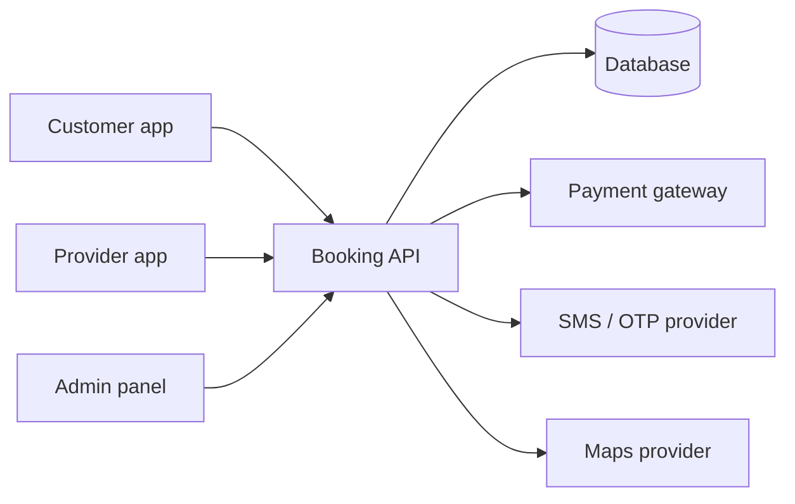
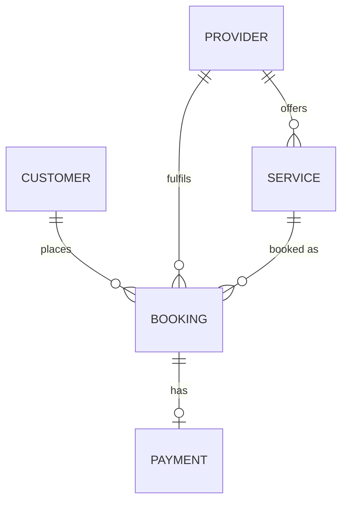

# Specification Templates — Documents 05 to 07

The engineering half of the package. `01-prd.md` is the primary product-requirements document.
These three documents add testable and technical detail and trace back to it. They do not restate
the PRD, and they do not turn the sample rows in this file into requirements.

Written in **English**. Audience: tech lead, backend, frontend.

Do not invent behavior, statuses, entities, or endpoints that the PRD left open. A speculative
field is an assumption `A-xx` or an open question `Q-xx`, not a final requirement. The backend
handoff stays traceable to confirmed product behavior.

**Load `../feature-forge/references/ears-syntax.md`** before writing the SRS — it holds the full
EARS pattern set and worked examples. Only the five-line quick reference is inlined below.

---

## 05 — `05-srs.md` (Software Requirements Specification)

Lean IEEE-830 shape. Every functional requirement is written in EARS so it is unambiguous and
directly testable. Every non-functional requirement carries a number.

````markdown
# Software Requirements Specification — <Product Name>

Version 1.0 · Derived from `01-prd.md`, `02-business-rules.md`, `03-use-cases.md`,
`04-permission-matrix.md`. Every requirement below traces to at least one of them.
Each `FR-xx` formalizes a confirmed PRD behavior. If the behavior is still `Q-xx`, do not write
an `FR-xx` that pretends it is confirmed.

## 1. Purpose and scope
What this system does, its boundaries, and what it explicitly does not do. Name the platform from
the run log when it is Confirmed. When it is still Open, say so and do not invent a compatibility
target.

## 2. System context



| External system | Purpose | Protocol | Owned by | Failure behaviour |
|-----------------|---------|----------|----------|-------------------|
| Payment gateway | Card charges, refunds | HTTPS REST + webhook | Third party | Hold booking, retry, never double-charge |

## 3. Actors
One line per actor, cross-referenced to `04-permission-matrix.md`. Include non-human actors:
scheduler, webhook caller, admin script.

## 4. Functional requirements

EARS quick reference — full syntax in `../feature-forge/references/ears-syntax.md`:

| Type | Structure | Use when |
|------|-----------|----------|
| Ubiquitous | The system shall `<action>` | Always applies |
| Event-driven | When `<trigger>`, the system shall `<action>` | On an event |
| State-driven | While `<state>`, the system shall `<action>` | Continuous state |
| Conditional | While `<state>`, when `<trigger>`, the system shall `<action>` | State + trigger |
| Optional | Where `<feature>` is enabled, the system shall `<action>` | Feature-flagged |

Group by module. One requirement per behaviour — if a requirement contains "and" joining two
independent behaviours, split it.

### 4.1 Authentication

**FR-01 · Phone registration**
When a guest submits a phone number in valid E.164 form, the system shall create a pending account
and send a 6-digit OTP valid for 5 minutes.
*Realizes*: UC-01 · *Enforces*: BR-02 · *Priority*: Must · *Verify*: integration test

**FR-02 · OTP rejection**
While an OTP is expired or incorrect, when verification is attempted, the system shall reject it,
increment the attempt counter, and leave the account pending.
*Realizes*: UC-01 · *Enforces*: BR-03 · *Priority*: Must · *Verify*: integration test

**FR-03 · Attempt lockout**
While the failed OTP count for a phone number reaches 5 within 15 minutes, when verification is
attempted, the system shall reject it and refuse further attempts for 30 minutes.
*Realizes*: UC-01 · *Enforces*: BR-04 · *Priority*: Must · *Verify*: integration test

<repeat per module: Booking, Payment, Notifications, Search, Profile, Admin, …>

### Requirement attributes
Every `FR-xx` carries: **Realizes** (`UC-xx`), **Enforces** (`BR-xx`, if any), **Priority**
(Must / Should / Could), and **Verify** (unit · integration · e2e · manual · inspection).
The Verify column becomes the `TC-xx` seed at stage 12.

## 5. Non-functional requirements

**Every NFR has a number. A target without a number is rejected at the gate.**

| # | Category | Requirement | Target | Measured how |
|---|----------|-------------|--------|--------------|
| NFR-01 | Performance | Screen-to-interactive on 4G, mid-tier Android | p95 ≤ 2.5 s | Synthetic run, 20 samples |
| NFR-02 | Performance | API read latency | p95 ≤ 300 ms, p99 ≤ 800 ms | APM |
| NFR-03 | Scale | Concurrent active users | 2,000 | Load test |
| NFR-04 | Scale | Bookings per day at launch → year 1 | 500 → 5,000 | Capacity plan |
| NFR-05 | Availability | Monthly uptime | ≥ 99.5% | Uptime monitor |
| NFR-06 | Recovery | RTO / RPO | 4 h / 15 min | Restore drill |
| NFR-07 | Security | Password / token storage | bcrypt cost 12; JWT 15 min access, 7 d refresh | Code review |
| NFR-08 | Security | Transport | TLS 1.2+ only | Scan |
| NFR-09 | Privacy | PII at rest | Encrypted; phone hashed for lookup | Code review |
| NFR-10 | Privacy | Data retention | Bookings 7 years, logs 90 days | Policy + job |
| NFR-11 | Accessibility | Conformance | WCAG 2.1 AA | Audit |
| NFR-12 | Localization | Primary locale | Arabic, RTL; Latin digits `0-9`; `<calendar>` | Manual |
| NFR-13 | Compatibility | Minimum OS / browsers | iOS 15+, Android 9+, last 2 Chrome/Safari | Matrix test |
| NFR-14 | Offline | Behaviour without connectivity | Cached reads, queued writes, explicit stale banner | Manual |
| NFR-15 | Observability | Logging, tracing, alerting | Structured logs, trace id per request, alert on 5xx > 1% | Inspection |

Categories to cover at minimum: performance · scale · availability · recovery · security ·
privacy · accessibility · localization · compatibility · offline · observability ·
maintainability. Drop one only with a stated reason.

## 6. External interfaces

Per integration: purpose, direction, protocol, auth method, rate limits, sandbox availability,
webhook events consumed, retry and idempotency strategy, and what the product does when it is down.

## 7. Constraints and dependencies

| # | Constraint | Type | Impact |
|---|-----------|------|--------|
| C-01 | Existing customer database must be reused | Technical | Data model 06 must map to it |
| C-02 | Launch before Ramadan | Schedule | Drives the MVP cut in 01 §5 |

## 8. Requirements verification

| FR | Verified by | Where |
|----|-------------|-------|
| FR-01 | Integration test | TC-xx (stage 12) |

Filled with `TC-xx` at stage 12; leave the column ready.

## 9. Traceability summary
Requirement count by module and by priority, plus a `UC-xx → FR-xx` coverage table.
Any use case with no requirement is a gap — list it explicitly.
````

**Quality bar**: every `FR-xx` is one EARS sentence with a subject the system controls; every
`UC-xx` from document 03 is realized by at least one `FR-xx`; every `BR-xx` that the system must
enforce is named by at least one `FR-xx`; every NFR row has a number and a measurement method.

---

## 06 — `06-data-model.md`

Audience: backend. Enough that a schema can be written without guessing.

Trace entities to confirmed PRD behavior. Do not treat the sample attributes, enums, or status
values below as requirements for the current product. Unnamed statuses stay open questions.

````markdown
# Data Model — <Product Name>

Conceptual and logical model. Not a migration — no vendor-specific types, no indexes beyond those
a rule requires. The implementing team owns the physical schema.

## 1. Entity relationship diagram



Re-authored as inline SVG at stage 17 using the recipe in `html-docs-guide.md` §9.

## 2. Entity dictionary

### EN-01 — Customer
Represents a verified end user who books services.

| Attribute | Type | Null | Constraint / default | Rule |
|-----------|------|:----:|----------------------|------|
| id | UUID | no | primary key | — |
| phone | string(16) | no | unique among active, E.164 | BR-02 |
| phone_verified_at | timestamp | yes | — | BR-03 |
| full_name | string(120) | no | Arabic or Latin, trimmed | — |
| locale | enum | no | default `ar` | NFR-12 |
| status | enum | no | `pending` \| `active` \| `suspended` \| `deleted`, default `pending` | BR-18 |
| created_at / updated_at | timestamp | no | audit | — |
| deleted_at | timestamp | yes | soft delete | BR-19 |

**Relationships**: has many Booking (EN-03) · has one Profile (EN-02)
**Lifecycle**: `pending → active → suspended → active`; `→ deleted` from any state (BR-18)
**Volume**: ~50k at year 1, growing 3k/month
**Retention**: 7 years after last booking (NFR-10)
**PII**: `phone`, `full_name` — encrypted at rest (NFR-09)

<repeat per entity>

## 3. Enumerations

| Enum | Values | Used by | Rule |
|------|--------|---------|------|
| booking_status | pending, confirmed, in_progress, completed, cancelled, no_show | EN-03 | BR-06 |

Values are stable identifiers, not display labels. Arabic display strings live in the UI layer,
not the database — say so explicitly.

## 4. Relationships

| From | To | Cardinality | On delete | Rule |
|------|----|-------------|-----------|------|
| Booking | Customer | many-to-one | restrict | BR-19 |

## 5. Conventions

- **Primary keys**: UUID v4, generated by the application.
- **Timestamps**: UTC, `created_at` / `updated_at` on every entity (NFR-12 renders local).
- **Soft delete**: `deleted_at` nullable; all reads filter it (BR-19).
- **Audit trail**: which entities need who-changed-what history, and what is recorded.
- **Money**: stored as integer minor units with an explicit currency column — never float.
- **Arabic text fields**: full Unicode, `utf8mb4` or equivalent; collation must sort Arabic
  correctly; length limits counted in characters, not bytes.
- **Localized content**: which fields need per-locale values and how they are stored
  (side table vs JSON column) — decide once here.

## 6. Derived and computed values
What is stored versus computed on read, and why. Cross-reference the calculation rules in
`02-business-rules.md`.

## 7. Data volume and growth
Row estimates at launch and year 1 per entity, feeding NFR-03/04.

## 8. Open data questions
`Q-xx` items the client must answer before the schema is final.
````

**Quality bar**: every entity referenced by an endpoint in `07-api-surface.md` exists here; every
`BR-xx` that constrains data names the attribute it constrains; no attribute has an unexplained
type; the localization strategy for Arabic content is stated, not implied.

---

## 07 — `07-api-surface.md`

Audience: backend and frontend together. Enough to agree on the contract and start in parallel.

````markdown
# API Surface — <Product Name>

**This is a sketch, not a final requirement.** It proposes the shape of the contract — resources,
methods, auth, and error semantics — so frontend and backend can start in parallel. The
implementing team owns the final OpenAPI document, status-code minutiae, and payload details.
Every endpoint traces to a confirmed PRD behavior or is marked `A-xx`. Do not present a sample
payload from this template as a confirmed contract.

## Conventions

- Base path `/api/v1`. JSON request and response bodies, `Content-Type: application/json`.
- Auth: `Authorization: Bearer <jwt>` unless marked public. Permissions come from
  `04-permission-matrix.md`; the API never grants more than that matrix allows.
- Errors: `{ "error": { "code": "BOOKING_TOO_LATE", "message": "...", "field": "..." } }`.
  `code` is a stable identifier; `message` is for logs, not for display — the client renders
  Arabic copy keyed off `code`.
- Pagination: cursor-based, `?limit=20&cursor=…`, response `{ data: [], next_cursor: null }`.
- Idempotency: every non-GET that creates or charges accepts `Idempotency-Key` (BR-xx, E-03).
- Timestamps: ISO 8601 UTC. Money: integer minor units plus a `currency` field.
- Localization: `Accept-Language: ar` by default; server-generated text follows it.

## Endpoints

### Bookings

#### API-12 · Create booking
`POST /api/v1/bookings` · auth: Customer · permission: `Place booking`

**Realizes** UC-04 · **Implements** FR-18, FR-19 · **Enforces** BR-01, BR-05 · **Entities** EN-03, EN-05

Request
```json
{ "service_id": "uuid", "provider_id": "uuid", "starts_at": "2026-08-02T09:00:00Z", "notes": "string?" }
```

Success `201`
```json
{ "id": "uuid", "status": "pending", "starts_at": "...", "total": 16200, "currency": "SAR",
  "expires_at": "2026-07-26T10:10:00Z" }
```

Errors
| Status | Code | When | Rule |
|--------|------|------|------|
| 409 | SLOT_TAKEN | Another booking claimed the slot | BR-05 |
| 422 | TOO_LATE | Start time inside the cutoff window | BR-01 |
| 403 | ROLE_FORBIDDEN | Caller is not a Customer | 04 matrix |

<repeat per endpoint, grouped by resource>

## Endpoint index

| # | Method | Path | Auth | Permission | Realizes |
|---|--------|------|------|-----------|----------|
| API-12 | POST | /bookings | Customer | Place booking | UC-04 |

## Use case coverage

| Use case | Endpoints | Complete? |
|----------|-----------|:---------:|
| UC-04 Book an appointment | API-10, API-12, API-14 | ✅ |

Any use case with no endpoint, or any endpoint realizing no use case, is a gap — list it.

## Permission cross-check
Every endpoint's required permission exists as a row in `04-permission-matrix.md`, and every
capability in that matrix is reachable through at least one endpoint. Report mismatches.

## Webhooks and callbacks
Inbound events consumed, their payload shape, verification method, and idempotency handling.

## Rate limits and abuse controls
Per endpoint where it matters — OTP send, search, booking creation.

## Not specified here
Field-level validation messages, exact status codes for every branch, response envelopes for list
endpoints beyond the pagination convention, and the OpenAPI document itself.
````

**Quality bar**: every endpoint names its permission and that permission exists in document 04;
every entity referenced exists in document 06; every use case in document 03 is covered or
explicitly listed as a gap; error codes are stable identifiers, never user-facing Arabic.
