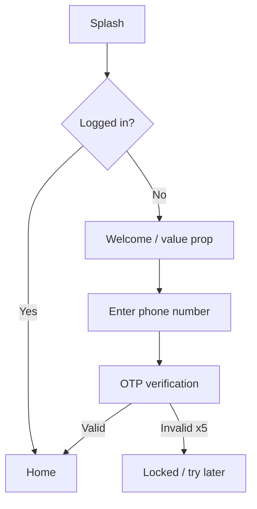

# UX Structure Templates — Documents 09 to 11

The bridge between the specification (05–08) and the design (13–15). Written in **English**;
Arabic appears only in the "Arabic UI title" column of the screen list.

Ids are permanent once written: `F-xx`, `S-xx`, `E-xx`.

---

## 09 — `09-user-flows.md`

One flow per primary use case. Add a cross-cutting journey (onboarding, auth, payment, recovery)
only when the source or the PRD supports it, and tag invented steps as assumptions. Do not invent
status transitions; point at the open question in `01-prd.md` §8.

````markdown
# User Flows — <Product Name>

## Flow index

| # | Flow | Actor | Realizes | Entry point | Screens |
|---|------|-------|----------|-------------|---------|
| F-01 | First-time onboarding and sign-up | Guest → Customer | UC-01 | App install | S-01…S-06 |

---

## F-01 — <Flow name>

**Actor**: Customer · **Realizes**: UC-01, UC-02 · **Goal**: <one line>
**Requirements**: FR-01, FR-02, FR-03 · **Rules**: BR-02, BR-03, BR-04



### Steps
1. **Splash** — the app checks the session token.
2. **Welcome** — three-panel value proposition, skippable.
3. …

### Decision points
| Node | Condition | True path | False path | Rule |
|------|-----------|-----------|------------|------|
| B | Valid session token exists | Home | Welcome | BR-02 |

### Failure and exit points
| Where | What goes wrong | System response | Rule | Edge case |
|-------|-----------------|-----------------|------|-----------|
| E | OTP expires | Offer resend, 60 s cooldown | BR-03 | E-04 |

### Screens touched
S-01, S-02, S-03, S-04, S-05, S-06 — *(fill after stage 10; use screen names on the first pass)*

### Cross-role handoff
Where the flow crosses roles (customer submits → admin approves), say so and name the other flow.
````

**Rules for flows**
- Use `flowchart TD`. Keep node labels short — they become screen names at stage 10.
- Every decision node needs both branches drawn. A flow with no failure branch is unfinished.
- Show where the flow ends: success, abandonment, or handoff to another flow.
- Every `UC-xx` in `03-use-cases.md` has at least one flow. Report any that does not.
- Alternate flows `UC-01.a` appear as branches, not as separate diagrams, unless they are long.

---

## 10 — `10-screen-list.md`

````markdown
# Screen List — <Product Name>

<count> screens across <count> modules.
**Platform**: <confirmed platform from `00-run-log.md` — mobile app · responsive web · both · admin back-office. If still open, ask before writing platform-only screens.>

## Coverage check
Every node in `09-user-flows.md` maps to a screen below. Screens added beyond the flows are marked
`[implied]` with a reason, so the client can cut them. Screens that exist only because of the
platform choice are marked `[platform]`.

---

## Module: Authentication

| ID | Screen (EN) | Arabic UI title | Purpose | Entry from | Exits to | Key components | Data shown | Actions | Roles | Requirements |
|----|-------------|-----------------|---------|-----------|----------|----------------|-----------|---------|-------|--------------|
| S-01 | Splash | — | Session check + brand moment | App launch | S-02, S-10 | Logo, loader | — | — | All | FR-00 |
| S-02 | Welcome | مرحباً بك | Value proposition | S-01 | S-03 | Carousel, CTA, skip | 3 slides | Next, Skip | Guest | — |
| S-03 | Phone entry | تسجيل الدخول | Collect phone | S-02 | S-04 | Country picker, input, CTA | — | Continue | Guest | FR-01 |
| S-04 | OTP entry | رمز التحقق | Verify phone | S-03 | S-05, S-10 | 6-digit input, resend timer | Masked phone | Verify, Resend | Guest | FR-01, FR-02 |

<repeat per module: Onboarding, Home/Browse, Search, Detail, Cart/Checkout, Orders, Profile,
Settings, Notifications, Support, Admin …>

## Screen index by role

| Screen | Guest | Customer | Provider | Admin |
|--------|:-----:|:--------:|:--------:|:-----:|
| S-01 | ✅ | ✅ | ✅ | ✅ |

Must agree with `04-permission-matrix.md`. Any disagreement is a gap for stage 16.
````

**Screens that flows always imply — include them unless explicitly ruled out.**

Which ones apply depends on the **confirmed platform** in `00-run-log.md`. If that row is still
open, ask the Arabic platform question before adding any platform-only screen. Do not guess a
platform to fill the list. Getting this wrong produces a web app with a splash screen and a
camera-permission primer, or a mobile app with a print view.

*Every platform:*
welcome/onboarding · sign-up, sign-in, OTP, forgot/reset password · home/dashboard · search +
results + empty results · filters and sort · list and detail for each core entity · create/edit
forms for each core entity · confirmation and success screens · cart, checkout, payment result ·
history/orders list + detail · profile view + edit · settings · notifications inbox ·
help/support/contact · legal (terms, privacy) · error, offline, maintenance.

*Mobile app only:*
splash · permission primers (location, notifications, camera, contacts) · force-update ·
app-rating prompt · biometric unlock · deep-link cold-start landing.

*Web and admin only:*
404 and 500 pages · print view for anything a user will plausibly print (invoice, booking, report) ·
session-expired page · browser-unsupported notice · shareable public landing for deep-linked
content · account-switching if multi-tenant.

*Admin / back-office only:*
list + detail + approval queue per managed entity · bulk-action confirmation · audit log ·
user and role management · export/report builder · system settings.

Mark each `[implied]` if the Arabic source did not name it. An implied screen is an assumption,
not a confirmed requirement. Mark any screen that exists only
because of the platform choice — those are the first to disappear if the platform later changes.

**Column notes**
- **Arabic UI title** — the real string that will appear on the screen. Stage 14 reuses it verbatim.
- **Requirements** — the `FR-xx` this screen surfaces. Filled from `05-srs.md`; a screen surfacing
  no requirement is either decoration or a missing requirement — decide which at the gate.
- **Roles** — must match `04-permission-matrix.md`.

---

## 11 — `11-states-and-edge-cases.md`

Write confirmed UI states from the source and the PRD. A state the source did not describe is an
assumption or an open question, not a confirmed requirement. Do not invent domain statuses to fill
the table. The rows below are a format sample; do not copy them into a run.

````markdown
# User States & Edge Cases — <Product Name>

## Part A — Per-screen states

For each screen in `10-screen-list.md` that has more than a default state.

### S-08 — Search results
| State | When it happens | What the UI shows | Primary action | Rule | Test |
|-------|-----------------|-------------------|----------------|------|------|
| Default | Results returned | Result list, count, filter bar | Open result | — | TC-030 |
| Loading | Request in flight | Skeleton rows, not a spinner | — | — | TC-031 |
| Empty — no results | Query returns 0 | Illustration + "no results for X" + suggestions | Clear filters | — | TC-032 |
| Empty — first use | User has never searched | Recent and popular suggestions | Tap a suggestion | — | — |
| Error | Request failed | Inline error + retry, query preserved | Retry | — | TC-033 |
| Offline | No connectivity | Cached results with a stale banner | Retry | NFR-14 | TC-034 |
| Partial | Some sections failed | Render what loaded, inline retry on the failed block | Retry section | — | — |
| Unauthorized | Role lacks access | Explain and route to the right place | Go back / sign in | BR-22 | TC-060 |

The **Test** column is filled at stage 12. Leave it present and empty until then.

<repeat per screen>

## Part B — Account and session states

| State | Definition | Affected screens | Behaviour | Rule |
|-------|-----------|------------------|-----------|------|
| Guest | No account | S-01…S-09 | Browse allowed; actions prompt sign-in | BR-05 |
| New — profile incomplete | Signed up, required fields missing | S-10 | Forced completion before first booking | BR-07 |
| Verified | Documents approved | All | Full access | BR-21 |
| Suspended | Admin action | All | Read-only + appeal route | BR-18 |
| Deleted / deactivated | User request | — | Sign-out + restore window | BR-19 |

## Part C — Cross-cutting edge cases

| # | Edge case | Where it bites | Expected behaviour | Rule | Test |
|---|-----------|----------------|--------------------|------|------|
| E-01 | Session expires mid-form | Any form | Preserve entered data, re-auth inline, resume | BR-11 | |
| E-02 | Network drops mid-payment | Checkout | Idempotent retry, never double-charge, show pending | BR-14 | |
| E-03 | Duplicate submit (double tap) | All CTAs | Disable on first tap, idempotency key | — | |
| E-04 | Permission denied after prompt | Location/camera screens | Manual fallback, deep link to settings | — | |
| E-05 | Very long Arabic text | Titles, names, addresses | Two-line clamp + ellipsis, full text on detail | — | |
| E-06 | Mixed Arabic + Latin + digits | Names, addresses, prices | Correct bidi isolation, no reversed digit runs | — | |
| E-07 | Number, date, currency formatting | Everywhere | Latin digits `0-9` always; dates per the run-log calendar | NFR-12 | |
| E-08 | Very large list | Any list | Pagination or virtualization, visible loading tail | NFR-02 | |
| E-09 | Stale data after backgrounding | Detail screens | Refresh on focus, show updated-at | — | |
| E-10 | Time zone / DST | Bookings, schedules | Store UTC, render local, label the zone | — | |
| E-11 | Concurrent edit / slot already taken | Booking, checkout | Detect conflict, offer alternatives, never fail silently | BR-05 | |
| E-12 | Force update required | App launch | Blocking screen with store link | — | |

Add domain-specific edge cases beyond this list — payment holds, delivery-window expiry,
prescription validity, whatever this product's real failure modes are. The generic twelve are a
floor, not a ceiling.

## Part D — Empty-state inventory

| Screen | Empty because | Message intent (English) | Action offered |
|--------|---------------|--------------------------|----------------|
| S-15 Orders | Never ordered | Encourage a first order | Browse |
| S-15 Orders | Filtered to nothing | Explain the filter | Clear filter |

*(Arabic copy for these is written at stage 14, not here.)*

## Part E — Error message inventory

| Trigger | Rule | English intent | Where shown | Recovery offered |
|---------|------|----------------|-------------|------------------|
| Booking inside cutoff window | BR-01 | Explain the cutoff and offer reschedule | S-22 inline | Pick another slot |

Every `BR-xx` with a "violation response" in `02-business-rules.md` appears here. This inventory is
what stage 14 turns into Arabic copy and stage 12 turns into negative tests.
````

**Quality bar for stage 11**: every screen with network data has loading, empty, and error rows;
every business rule that a user can violate appears in Part C or Part E with its UI response; every
edge case has an owner screen.
